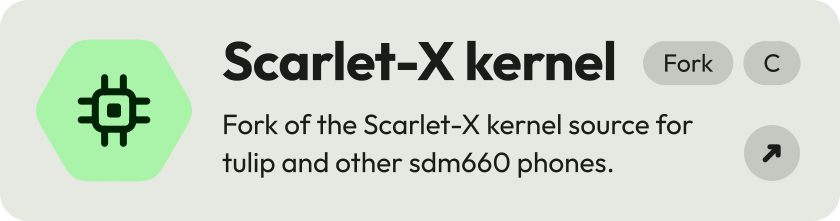
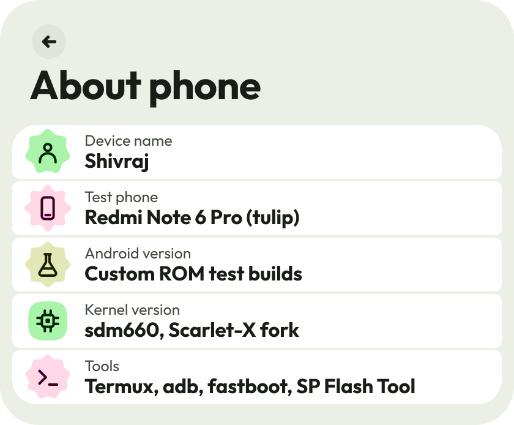

  <picture>
    <source media="(prefers-reduced-motion: reduce) and (prefers-color-scheme: dark)" srcset="assets/static/hero-dark.svg">
    <source media="(prefers-reduced-motion: reduce)" srcset="assets/static/hero-light.svg">
    <source media="(prefers-color-scheme: dark)" srcset="assets/hero-dark.svg">
    
  </picture>

  <picture>
    <source media="(prefers-reduced-motion: reduce) and (prefers-color-scheme: dark)" srcset="assets/static/divider-dark.svg">
    <source media="(prefers-reduced-motion: reduce)" srcset="assets/static/divider-light.svg">
    <source media="(prefers-color-scheme: dark)" srcset="assets/divider-dark.svg">
    
  </picture>

  <picture>
    <source media="(prefers-reduced-motion: reduce) and (prefers-color-scheme: dark)" srcset="assets/static/heading-projects-dark.svg">
    <source media="(prefers-reduced-motion: reduce)" srcset="assets/static/heading-projects-light.svg">
    <source media="(prefers-color-scheme: dark)" srcset="assets/heading-projects-dark.svg">
    
  </picture>

  <a href="https://github.com/shivrajtode/spft">
    <picture>
      <source media="(prefers-reduced-motion: reduce) and (prefers-color-scheme: dark)" srcset="assets/static/card-spft-dark.svg">
      <source media="(prefers-reduced-motion: reduce)" srcset="assets/static/card-spft-light.svg">
      <source media="(prefers-color-scheme: dark)" srcset="assets/card-spft-dark.svg">
      
    </picture>
  </a>

  <a href="https://github.com/shivrajtode/flashkit">
    <picture>
      <source media="(prefers-reduced-motion: reduce) and (prefers-color-scheme: dark)" srcset="assets/static/card-flashkit-dark.svg">
      <source media="(prefers-reduced-motion: reduce)" srcset="assets/static/card-flashkit-light.svg">
      <source media="(prefers-color-scheme: dark)" srcset="assets/card-flashkit-dark.svg">
      
    </picture>
  </a>

  <a href="https://github.com/shivrajtode/TouchGuard">
    <picture>
      <source media="(prefers-reduced-motion: reduce) and (prefers-color-scheme: dark)" srcset="assets/static/card-touchguard-dark.svg">
      <source media="(prefers-reduced-motion: reduce)" srcset="assets/static/card-touchguard-light.svg">
      <source media="(prefers-color-scheme: dark)" srcset="assets/card-touchguard-dark.svg">
      
    </picture>
  </a>

  <a href="https://github.com/shivrajtode/scarlet_xiaomi_sdm660">
    <picture>
      <source media="(prefers-reduced-motion: reduce) and (prefers-color-scheme: dark)" srcset="assets/static/card-scarlet-dark.svg">
      <source media="(prefers-reduced-motion: reduce)" srcset="assets/static/card-scarlet-light.svg">
      <source media="(prefers-color-scheme: dark)" srcset="assets/card-scarlet-dark.svg">
      
    </picture>
  </a>

  <picture>
    <source media="(prefers-reduced-motion: reduce) and (prefers-color-scheme: dark)" srcset="assets/static/divider-dark.svg">
    <source media="(prefers-reduced-motion: reduce)" srcset="assets/static/divider-light.svg">
    <source media="(prefers-color-scheme: dark)" srcset="assets/divider-dark.svg">
    
  </picture>

  <picture>
    <source media="(prefers-color-scheme: dark)" srcset="assets/about-dark.svg">
    
  </picture>

  <a href="https://t.me/Shivraj_editx">
    <picture>
      <source media="(prefers-reduced-motion: reduce) and (prefers-color-scheme: dark)" srcset="assets/static/contact-dark.svg">
      <source media="(prefers-reduced-motion: reduce)" srcset="assets/static/contact-light.svg">
      <source media="(prefers-color-scheme: dark)" srcset="assets/contact-dark.svg">
      
    </picture>
  </a>

Material 3 Expressive style, generated by <a href="tools/build.py">tools/build.py</a>. Plain SVG: no scripts, no tracking, no external images. Not affiliated with Google.

